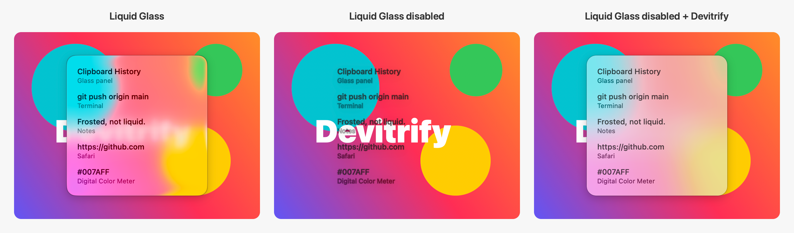

# Devitrify

Devitrify turns Liquid Glass back into frosted glass on macOS Tahoe and macOS Golden Gate.

With Liquid Glass disabled, apps that still use glass views such as `NSGlassEffectView` draw them fully transparent, leaving text floating over whatever is behind the window. Devitrify replaces every one of them with classic frosted glass, without any per-app configuration. Where Liquid Glass stays on, it strips the refraction and keeps a plain blur.

## Usage
1. [Turn off System Integrity Protection](https://developer.apple.com/documentation/security/disabling-and-enabling-system-integrity-protection) by running `csrutil disable` in recoveryOS
2. Install the Xcode Command Line Tools by running `xcode-select --install`
3. Download [Devitrify](https://codeload.github.com/AotianNeo/Devitrify/zip/refs/heads/main) and unzip it
4. Open Terminal and run `~/Downloads/Devitrify-main/devitrify`
5. When the script lists apps that were already running, let it quit and reopen them so they load Devitrify

This has been tested on macOS Golden Gate 27.2. The script checks that the `amfi_get_out_of_my_way=0x1` and `-arm64e_preview_abi` boot arguments are set, offers to add them if they are missing (run the script again after the reboot), builds Devitrify from source, copies it to `/Users/Shared/.devitrify` and installs a login agent that loads it into every app you open.

To uninstall, run `~/Downloads/Devitrify-main/devitrify` again, then log out and back in. To clear the boot argument change, run `sudo nvram -d boot-args`.

## Screenshot


## Tip: Disable Liquid Glass
Devitrify is meant to be used with Liquid Glass disabled. To disable Liquid Glass, open Terminal and run the following command. You won't see your password as you type. Changes take effect after restart.

```
sudo mkdir -p /Library/Preferences/FeatureFlags/Domain
sudo defaults write /Library/Preferences/FeatureFlags/Domain/SwiftUI.plist Solarium -dict Enabled -bool false
defaults write -g NSAlertGlassSolariumEnabled -bool false
```

Control Center and Notification Center don't work correctly with Liquid Glass disabled. [launchbad-revived](https://github.com/nfzerox/launchbad-revived) relaunches them with Liquid Glass enabled, and Devitrify turns their glass into frosted blur.

To re-enable Liquid Glass, open Terminal and run the following command. Changes take effect after restart.

```
sudo defaults delete /Library/Preferences/FeatureFlags/Domain/SwiftUI.plist
defaults delete -g NSAlertGlassSolariumEnabled
```

## Tip: Customize the blur radius
Where Liquid Glass stays on, Devitrify blurs with a radius of 25 points. To change it until you log out, open Terminal and run the following commands, then reopen your apps.

```
launchctl setenv DEVITRIFY_BLUR_RADIUS 30
launchctl kickstart -k gui/$(id -u)/com.apple.controlcenter
launchctl kickstart -k gui/$(id -u)/com.apple.notificationcenterui.agent
```

## Tip: Reload apps that are already running
Apps and services only load Devitrify when they launch. To reload the ones that were started before Devitrify was loaded, for example windows restored at login, open Terminal and run the following command. It lists them first and asks before quitting and reopening the apps and before letting launchd restart the services, such as Finder and SystemUIServer. With Liquid Glass disabled, it only picks apps that use `NSGlassEffectView`, because nothing changes for the others. Services under `/System/Library` are always listed, because they use glass from system frameworks that can't be checked.

```
/Users/Shared/.devitrify/devitrify-refresh
```

Add `-n` to only list them. Add bundle identifiers such as `com.apple.Music` to reload only those apps, even if they already have Devitrify loaded.

## Tip: Keep Liquid Glass for specific apps
Apps built with SwiftUI's `.glassEffect()` lose their glass shapes when Liquid Glass is disabled, for example Calculator's keys or AlDente's menu. To let such an app keep Liquid Glass, which Devitrify then turns into frosted glass, add its name to `/Users/Shared/.devitrify/liquid-glass-apps` and reload it:

```
echo AlDente >> /Users/Shared/.devitrify/liquid-glass-apps
/Users/Shared/.devitrify/devitrify-refresh com.apphousekitchen.aldente-pro
```

The name is the app's file name without `.app`. The app's controls follow Liquid Glass too.

## How it works
- `libDevitrify.dylib` is injected into every process through `DYLD_INSERT_LIBRARIES`. It links nothing beyond libSystem and loads `DevitrifyCore.dylib` only into processes that already have AppKit loaded, so command-line tools are unaffected. For apps named in `liquid-glass-apps`, it first sets `FEATUREFLAGS_ENABLED=SwiftUI/Solarium`, before AppKit and SwiftUI read the feature flag.
- With Liquid Glass disabled, every `NSGlassEffectView` in an app window gets an `NSVisualEffectView` behind its content, clipped to the glass corner radius. Regular glass uses the popover material and clear glass the HUD material. Glass that fills its window blurs the desktop; glass inside a window blurs the window's content. Glass in AppKit's own windows, such as menus, is left alone because AppKit already draws it correctly.
- With Liquid Glass enabled, the `glassBackground` and `glassForeground` filters lose their refraction, edge bleed, chromatic aberration and shadow.

## Limitations
- The tint color of `NSGlassEffectView` isn't reproduced.
- SwiftUI's `.glassEffect()` and `.buttonStyle(.glass)` don't use `NSGlassEffectView`. With Liquid Glass disabled they draw only their content. Devitrify can't turn them into frosted glass directly; keep Liquid Glass for those apps instead.
- Apps restored at login before the login agent runs start without Devitrify until they are reopened, for example with `devitrify-refresh`.
- Sandboxed app extensions, such as the panes of System Settings, don't load Devitrify. They don't need it: with Liquid Glass disabled they already draw classic controls.
