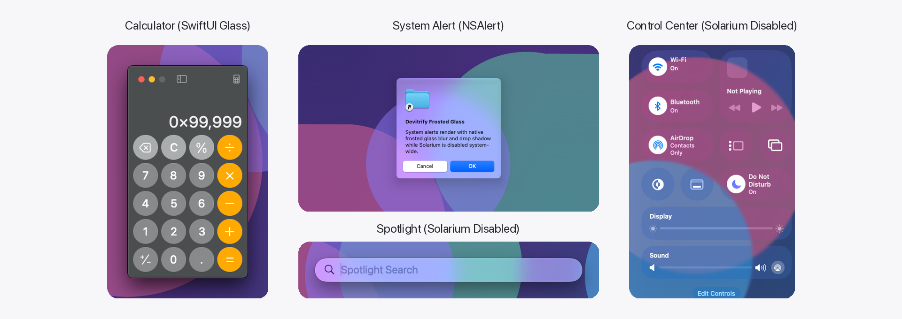

# Devitrify

Devitrify turns Liquid Glass back into classic frosted glass on macOS Tahoe (26) and macOS Golden Gate (27), and restores the classic macOS **Launchpad** in a single unified package.

With Liquid Glass disabled system-wide, Devitrify keeps all system and third-party apps—including Control Center, Notification Center, Spotlight (Siri AI), QuickTime Player and Screenshot (⌘⇧5), Apple Music, Calculator, System Alerts, and Mac Catalyst apps—working out of the box with classic AppKit and SwiftUI controls, native drop shadows, and uniform Gaussian frosted blur, with zero per-app configuration or whitelist required. At the same time, it restores the classic Launchpad experience removed in macOS 26/27 and automatically self-heals Launchpad across macOS system updates.

## Usage
1. [Turn off System Integrity Protection](https://developer.apple.com/documentation/security/disabling-and-enabling-system-integrity-protection) in recoveryOS
2. Install the Xcode Command Line Tools
3. Download [Devitrify](https://codeload.github.com/AotianNeo/Devitrify/zip/refs/heads/main) and unzip it
4. Open Terminal and run the installer script:

```bash
~/Downloads/Devitrify-main/devitrify
```

5. When the script lists apps that were already running, let it quit and reopen them so they load Devitrify

Tested on macOS Golden Gate 27.2. The installer checks the required AMFI boot arguments, offers to add them if missing, builds Devitrify and the Launchpad shims from source, installs the unified runtime into /Users/Shared/.devitrify, deploys Launchpad into /Applications/Launchpad.app, and registers a single login agent that activates everything at login.

To uninstall and restore the default system Dock and settings, run the installer script again, then log out and back in.

## Screenshot



## Tip: Disable Liquid Glass
Devitrify is designed to be used with Liquid Glass (SwiftUI/Solarium) disabled system-wide. Run the following commands in Terminal and restart your Mac:

```bash
sudo mkdir -p /Library/Preferences/FeatureFlags/Domain
sudo defaults write /Library/Preferences/FeatureFlags/Domain/SwiftUI.plist Solarium -dict Enabled -bool false
```

To re-enable Liquid Glass defaults, delete the feature flag plist and restart:

```bash
sudo defaults delete /Library/Preferences/FeatureFlags/Domain/SwiftUI.plist
```

## Tip: Zero-Restart Hot Reload & System-Wide Toggle
You can hot-reload changes, check hook status, or toggle Devitrify hooks across all running apps in real time (< 50 ms) without restarting any app:

```bash
make reload    # Hot-reload DevitrifyCore across all running apps
make disable   # Unhook and disable Devitrify system-wide in real time
make enable    # Re-enable Devitrify hooks system-wide in real time
make status    # Show current hook status and crash-bypass state
```

## Tip: Customize the Blur Radius
Devitrify uses a default Gaussian blur radius of 25 points for glass backgrounds. You can adjust it live across all running apps:

```bash
echo 30 > /Users/Shared/.devitrify/blur-radius
make reload
```

## How It Works
- **Process Loader & SwiftUI Compatibility Mode**: The lightweight loader library is injected via DYLD_INSERT_LIBRARIES and only loads DevitrifyCore into GUI processes that link AppKit, leaving command-line tools untouched. At image load time, it interposes SwiftUICore feature flag and SDK checks so Solarium evaluates to compatibility mode: explicit glass views (such as Calculator buttons, Control Center, Notification Center, and the ⌘⇧5 Screenshot bar) retain their frosted glass backdrop layers while SwiftUI and AppKit toolbars, split views, buttons, and menus stay 100% classic.
- **Spotlight (Siri AI) In-Process Recovery**: For processes linking SpotlightUIInternal, DevitrifyCore patches the SwiftUICore AllowedInCompatibilityKey getter in memory so Spotlight's search bar and results panel render their frosted glass background without enabling new-style SwiftUI controls in other apps.
- **QuartzCore Refraction & Rim Neutralization**: DevitrifyCore intercepts CAFilter and CASDFKeyFillHighlightEffect so glassBackground and glassForeground filters have their refraction, bleed, chromatic aberration, and specular highlight amounts zeroed out, leaving a clean Gaussian blur with native drop shadows intact.
- **Dynamic AppKit Classic Menus**: DevitrifyCore enforces classic AppKit popup menus and dynamically locates AppKit's in-memory glass menu configuration cache bytes via ARM64 instruction decoding—supporting instant live switching on hot-reload with zero hardcoded addresses.
- **33pt Notched Menu Bar & Window Manager Normalization**: The setuid helper patches WindowServer's SkyLight menu bar height check in memory (under task suspension for thread safety) to keep the compact 33-point notched menu bar height. In addition, DevitrifyCore normalizes NSCGSDisplay and NSScreen menu bar height queries on notched displays to 33 points and broadcasts screen parameter updates so window managers such as Rectangle always compute exact window frames.
- **Fault-Tolerant Crash Guard**: Both initial loading and live hot-reloads are wrapped in a POSIX signal guard (SIGSEGV, SIGBUS, SIGILL, SIGTRAP, SIGABRT) and Objective-C exception handler. If any hook ever faults in a process, Devitrify automatically rolls back all swizzles and inline patches in that process and marks it for bypass so the host app continues running without interruption.
- **Unified Launchpad Revived Integration**: DynamicDesktop.framework and WindowManagerShim.dylib are compiled from source and installed alongside the macOS 26 Launchpad-capable Dock and Launchpad bundles under /Users/Shared/.devitrify, with ad-hoc re-signing that preserves original entitlements across Dock and its XPCServices, and automatic login self-healing if a macOS update removes /Applications/Launchpad.app.
